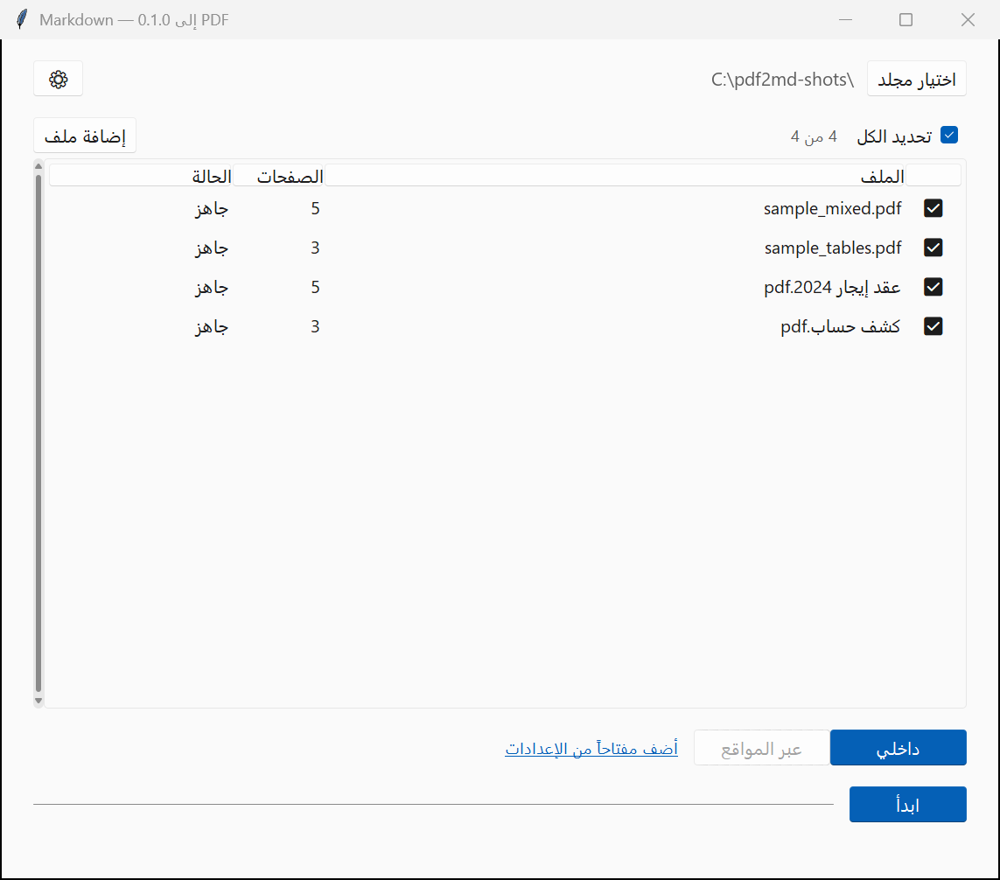

# pdf2md

**تحويل ملفات PDF إلى Markdown — عربي أولاً**

> برنامج لويندوز يحوّل ملفات PDF — خصوصاً العربية — إلى نص Markdown نظيف، تقدر تكتب منه تقريرك بدون ما ترجع للملف الأصلي.



---

## وش يسوي البرنامج؟

البرنامج يقرأ صفحات الـ PDF صفحة صفحة، ويحوّلها إلى Markdown جاهز:

- يطلع النص، والجداول، والصور.
- يصحّح أخطاء القراءة الآلية، خصوصاً في العربية.
- يقيّم جودة كل صفحة، ويرجّع الصفحات الضعيفة لك تراجعها بنفسك.
- يحفظ النتيجة بملف Markdown أو ملف Word بجانب ملف الـ PDF الأصلي.

مهمته الحقيقية إنك تقدر **تكتب تقرير من النتيجة مباشرة**، بدون ما ترجع للملف الأصلي ثانية.

---

## ثلاث طرق لقراءة الصفحة

البرنامج يقرأ كل صفحة بثلاث طرق ممكنة، ويقرّر **لكل صفحة وحدها** أي الطريقتين يناسبها. مو شرط تختار وحدة لملفك كله.

### ١) داخل جهازك — الوضع «داخلي»

كل شي يشتغل على جهازك. لا إنترنت، ولا مفتاح، ولا حد يومي، ولا ملف يطلع من عندك.

فيه محرّكين محليين:

- قارئ نصوص عربي مدمج يشتغل بالكامل بدون كرت شاشة.

  PaddleOCR

- موديل رؤية صغير يقدر تنزله على جهازك وتشغّله على المعالج العادي، بدون كرت رسمة.

  Qwen3-VL 4B

### ٢) قراءة أونلاين — بدون ذكاء اصطناعي

محركات القراءة تشتغل على سيرفرات الطرف الثالث. ترسل **صورة الصفحة** بس، وتاخذ نص.

- قارئ نصوص تقليدي، سريع، ومتوسط بالعربية — يعني بدقّة عالية؟ لأ.

  OCR.space

- ذكاء اصطناعي مخصّص للعربية، يشتغل على خوادم خارجية.

  Qari-OCR

- محرك قراءة من Google، قوي بالعربية والجداول الممسوحة، بس يحتاج فاتورة.

  Google Cloud Vision

### ٣) ذكاء اصطناعي خارجي

نموذج ذكي يقدر يقرأ الصفحة، يصحّح النص، ويضبط الجداول. أدقّ بالجداول من قارئ النص العادي، بس يحتاج مفتاح API.

  Google Gemini

  OpenAI

  Groq

  Mistral

  Cloudflare Workers AI

  NVIDIA NIM

  MiniMax

  OpenRouter

---

## ⚠️ نقطة مهمة قبل ما تحط مفتاح Google

**سقف مفتاح Gemini عند Google يعادل نحو ٣٠ ألف مستند في اليوم.**

يعني لو رفعت عنده أكثر من كذا، ما راح يحوّل لك الباقي إلا إذا دفعت أو انتظرت يوم ثاني. السقف على مستوى المشروع، ويصفّر كل يوم.

> الأرقام الدقيقة لحسابك تشوفها بنفسك من:
>
> https://aistudio.google.com/rate-limit

وفيه نقطة ثانية أهم، خصوصاً على الخطة المجانية:

> **محتوى المستند اللي يرسله البرنامج ممكن يُستخدم في تحسين منتجات Google.**

عشان كذا، **ينصح بالوضع الداخلي** إلا إذا احتجت فعلاً دقة النموذج الخارجي:

- مستنداتك ما تطلع من جهازك أبداً.
- ما في سقف يومي، ولا تكلفة، ولا انتظار.
- يشتغل حتى لو النت مقطوع.

الوضع الداخلي هو الافتراضي، وهو اللي تبدأ فيه. جرّب عليه أول، وإن ما عجبك، فعّل الوضع الخارجي للملفات الصعبة فقط.

---

## أيهما أختار؟

| وضعك | راح يناسبك |
|---|---|
| مستندات حسّاسة أو قانونية | الوضع الداخلي |
| شغلي على جهازي بدون إنترنت | الوضع الداخلي |
| ملف واحد مهم وبدي دقة عالية | ذكاء اصطناعي خارجي |
| ألاف الملفات المتشابهة | الوضع الداخلي أو محرك قراءة أونلاين |
| جداول معقّدة أو صفحات مدوّرة | ذكاء اصطناعي خارجي |

---

## المميزات

- واجهة عربية بالكامل، من اليمين لليسار، وتتبع وضع ويندوز الفاتح والداكن.
- استخراج الجداول وترتيبها في Markdown.
- قاموس عربي لتوحيد الأرقام: ١٢٣ تصير 123.
- درجة جودة لكل صفحة، ونافذة مراجعة للصفحات المشكلة.
- استئناف من مكان التوقف لو العملية انقطعت.
- فهرس للملفات وملخص لكل مستند.
- مخرجات Markdown وملف Word.
- أوقات المعالجة وملفات العمل تنحفظ بمجلد مؤقت، وتُنظّف بعد أسبوع.

---

## المتطلبات

- ويندوز 10 أو 11.
- بايثون 3.9 أو أحدث — لو تبي تشغّل البرنامج من المصدر.
- كارت رسمة اختياري: بدونه يشتغل، بس أبطأ.

---

## التشغيل

### طريقة سريعة: ملف جاهز

نزّل الملف من صفحة الإصدارات، شغّله، وخلاص. ما يحتاج بايثون ولا تثبيت أي شي.

  https://github.com/tch333-byte/pdf2md/releases

### من المصدر

```powershell
git clone https://github.com/tch333-byte/pdf2md.git
cd pdf2md

python -m venv .venv
.venv\Scripts\activate

pip install -r requirements.txt
python main.py
```

### فحص سريع للبرنامج

```powershell
python main.py --selftest
```

---

## بناء ملف exe مستقل

```powershell
pip install pyinstaller
pyinstaller pdf2md.spec
```

الناتج يكون بمجلد `dist`. هذا المجلد **ما ينرفع على GitHub** — هو ملفات مولّدة مو كود.

---

## الاختبارات

```powershell
python -m pytest tests/ -v
```

---

## بنية المشروع

```text
pdf2md/
├── main.py                  نقطة التشغيل
├── pdf2md.spec              إعدادات بناء الملف التنفيذي
├── app/
│   ├── ui/                  الواجهة
│   ├── providers/           محركات القراءة والمزوّدات
│   ├── pipeline.py          خط المعالجة
│   ├── markdown_out.py      إخراج Markdown
│   ├── docx_out.py          إخراج Word
│   ├── tables.py            استخراج الجداول
│   ├── dictionary.py        القاموس العربي
│   ├── quality.py           تقييم جودة الصفحات
│   ├── cloud_gate.py        بوابة إرسال الملفات
│   ├── secrets_store.py     حفظ المفاتيح
│   └── config.py            الإعدادات
├── resources/               كتالوج المزوّدين
├── samples/                 ملفات PDF تجريبية
├── screenshots/             لقطات الشاشة
├── style/                   أسلوب كتابة التقارير (مخطّط)
├── tests/                   الاختبارات
└── DEVLOG.md                سجل التطوير
```

---

## الإعدادات والمفاتيح

- المفاتيح تنحفظ بمخزن بيانات الاعتماد في ويندوز، أو بتشفير خاص بالجهاز.
- الإعدادات تنحفظ بمجلد بيانات التطبيق:

  %APPDATA%\pdf2md

- **ما في أي مفتاح داخل المستودع** — الملفات هذي كلها مستبعدة بملف `.gitignore`.
- في الوضع الداخلي، الكود نفسه يمنع أي اتصال خارجي يحمل محتوى المستند.
- في الوضع الخارجي، كل إرسال يمر على بوابة واحدة تفحص الملف قبل ما يطلع، وتسجّل المحاولة بسجل بدون نص المستند.

---

## المساهمة

أهلاً بأي مساحظة أو مساهمة. افتح Issue للبلاغ خطأ أو طلب ميزة.

سجل التطوير الكامل موجود بالملف:

  DEVLOG.md

---

## الرخصة

رخصة MIT — تقدر تستخدم البرنامج وتعدّله وتشاركه.
