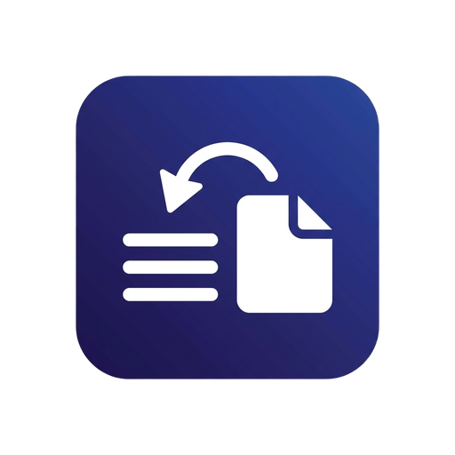

# pdf2md

<p align="center"></p>


**تحويل ملفات PDF إلى Markdown — مع العربية أولاً**

> برنامج لويندوز يحوّل ملفات PDF — ولا سيما العربية — إلى نص Markdown منظَّم، يمكن كتابة تقرير منه مباشرة دون الرجوع إلى الملف الأصلي.


---

## ماذا يفعل البرنامج؟

يقرأ البرنامج صفحات الملف صفحةً صفحة، ويحوّلها إلى Markdown جاهز:

- يستخرج النص والجداول والصور.
- يصحّح أخطاء القراءة الآلية، ولا سيما في اللغة العربية.
- يقيّم جودة كل صفحة، ويعيد الصفحات الضعيفة إلى المستخدم لمراجعتها.
- يحفظ النتيجة في ملف Markdown أو ملف Word بجوار الملف الأصلي.

الغاية الحقيقية من البرنامج هي تمكين المستخدم من كتابة تقرير انطلاقاً من النتيجة مباشرة، دون الرجوع إلى ملف PDF ثانية.

---

## ثلاث طرق لقراءة الصفحة

يقرأ البرنامج كل صفحة بثلاث طرق ممكنة، ويقرّر لكل صفحة على حدة أيّهما يناسبها. وليس من الضروري اختيار طريقة واحدة لكل ملف.

### ١) داخل الجهاز — الوضع «داخلي»

تعمل كل شيء على جهاز المستخدم: لا إنترنت، ولا مفتاح، ولا حدّ يومي، ولا ملف يخرج من الجهاز.

يوجد محرّكان محليان:

- قارئ نصوص عربي مدمج يعمل بالكامل دون كرت شاشة.

  PaddleOCR

- نموذج رؤية صغير يمكن تنزيله على الجهاز وتشغيله على المعالج العادي، دون كرت شاشة.

  Qwen3-VL 4B

### ٢) قراءة عبر الإنترنت — دون ذكاء اصطناعي

تعمل محركات القراءة على خوادم الطرف الثالث. يُرسَل إلى الخادم صورة الصفحة فقط، وتُؤخذ النتيجة نصاً.

- قارئ نصوص تقليدي، سريع، ومقبول في العربية — أي بدقّة عالية؟ لا.

  OCR.space

- ذكاء اصطناعي مخصّص للعربية، يعمل على خوادم خارجية.

  Qari-OCR

- محرك قراءة من Google، قوي في العربية والجداول الممسوحة، لكنه يتطلّب تفعيل الفوترة.

  Google Cloud Vision

### ٣) ذكاء اصطناعي خارجي

نموذج ذكي يقرأ الصفحة، ويصحّح النص، ويضبط الجداول. وهو أدقّ في الجداول من قارئ النص العادي، لكنه يتطلّب مفتاح API.

  Google Gemini

  OpenAI

  Groq

  Mistral

  Cloudflare Workers AI

  NVIDIA NIM

  MiniMax

  OpenRouter

---

## ⚠️ ملاحظة مهمة قبل إضافة مفتاح Google

**سقف مفتاح Gemini عند Google يعادل نحو ٣٠ ألف مستند في اليوم.**

فإذا تجاوز المستخدم هذا الحدّ، لن يحوّل البرنامج بقية الملفات إلا بالدفع أو بالانتظار حتى اليوم التالي. والسقف مطبَّق على مستوى المشروع، ويُصفَّر كل يوم.

> الأرقام الدقيقة الخاصة بالحساب تظهر في:
>
> https://aistudio.google.com/rate-limit

وثمّة ملاحظة ثانية لا تقلّ أهمية، وتخصّ الخطة المجانية بصفة خاصة:

> **محتوى المستند الذي يرسله البرنامج قد يُستخدَم في تحسين منتجات Google.**

ولهذا السبب، **يُنصح بالوضع الداخلي** إلا إذا احتاج المستخدم دقة النموذج الخارجي فعلاً:

- لا تخرج مستندات المستخدم من جهازه إطلاقاً.
- لا يوجد سقف يومي، ولا تكلفة، ولا انتظار.
- يعمل البرنامج حتى عند انقطاع الإنترنت.

الوضع الداخلي هو الوضع الافتراضي، وهو ما ينبغي البدء به. يُجرَّب أولاً، وإذا لم تناسب النتيجة، يُفعَّل الوضع الخارجي للملفات الصعبة فقط.

---

## أيّهما أختار؟

| الحالة | الخيار المناسب |
|---|---|
| مستندات حسّاسة أو قانونية | الوضع الداخلي |
| العمل على الجهاز دون إنترنت | الوضع الداخلي |
| ملف واحد مهم مع الحاجة إلى دقة عالية | ذكاء اصطناعي خارجي |
| آلاف الملفات المتشابهة | الوضع الداخلي أو محرك قراءة عبر الإنترنت |
| جداول معقّدة أو صفحات مدوّرة | ذكاء اصطناعي خارجي |

---

## المميزات

- واجهة عربية بالكامل، من اليمين إلى اليسار، تتتبّع وضعَي ويندوز الفاتح والداكن.
- استخراج الجداول وترتيبها داخل النص.
- قاموس عربي لتوحيد الأرقام: ١٢٣ تصبح 123.
- درجة جودة لكل صفحة، ونافذة مراجعة للصفحات ذات المشكلة.
- الاستئناف من موضع التوقف عند انقطاع العملية.
- فهرس للملفات وملخّص لكل مستند.
- مخرجات بصيغة Markdown وملف Word.
- تُحفظ أوقات المعالجة وملفات العمل في مجلّد مؤقّت، وتُنظَّف بعد أسبوع.

---

## المتطلبات

- ويندوز 10 أو 11.
- بايثون 3.9 أو أحدث — عند الرغبة في تشغيل البرنامج من المصدر.
- كرت شاشة (اختياري): مهم للنموذج الذكي الداخلي — يعمل بدونه، لكن وجوده يسرّع عملية التحويل.

---

## التشغيل

### طريقة سريعة: ملف جاهز

يُنزَّل الملف من صفحة الإصدارات، ثم يُشغَّل مباشرة. لا يحتاج بايثون ولا تثبيت أي شيء.

  https://github.com/Enezy1/pdf2md/releases

### من المصدر

```powershell
git clone https://github.com/Enezy1/pdf2md.git
cd pdf2md

python -m venv .venv
.venv\Scripts\activate

pip install -r requirements.txt
python main.py
```

### فحص سريع للبرنامج

```powershell
python main.py --selftest
```

---

## بناء ملف تنفيذي مستقل

```powershell
pip install pyinstaller
pyinstaller pdf2md.spec
```

ينتج الملف في مجلّد `dist`. وهذا المجلّد لا يُرفع على GitHub، فهو ملفات مولَّدة لا كود.

---

## الاختبارات

```powershell
python -m pytest tests/ -v
```

---

## التحقق من سلامة الملف

الملف التنفيذي **منشور بدون توقيع رقمي** (الشهادة التجارية تحتاج شركة معتمدة وكلفة سنوية)، فبدلاً منه نوفّر لك طريقتين مجانيتين للتحقق:

**١) بصمة SHA256**

كل إصدار يحمل ملف `SHA256SUMS.txt`. بعد التنزيل، افتح PowerShell في نفس المجلد ونفّذ:

```powershell
Get-FileHash .\pdf2md.exe -Algorithm SHA256
```

ثم قارن النتيجة بالسطر الموجود في `SHA256SUMS.txt`. تطابق البصمتان = الملف أصلي ولم يتغيّر.

**٢) إثبات مصدر البناء**

كل إصدار جديد يُبنى داخل GitHub Actions، ويُنشأ له «إثبات» يربطه بالـ commit الذي بُني منه. للتحقق:

```powershell
gh attestation verify pdf2md.exe --repo Enezy1/pdf2md
```

وتحتاج لتثبيت [GitHub CLI](https://cli.github.com) مرة واحدة.

الشرح الكامل في الملف:

  docs/CODE_SIGNING.md

---

## Code signing policy — سياسة التوقيع الرقمي

هذه السياسة تشرح ما الذي يُوقَّع مستقبلاً، ومن يوقّعه، وكيف يُتحقق من الملف. على المتصفحات التي تدعم الترجمة قد يظهر العنوان بالإنجليزية.

- **الحالة الآن**: الإصدارات منشورة **بدون** توقيع رقمي، ومغطاة ببصمة SHA256 وإثبات مصدر البناء.
- **عند توفر توقيع رسمي**: يُوقَّع ملف `pdf2md.exe` فقط، المبني من وسم `v*` داخل هذا المستودع، وتُوقَّع كل نسخة يدوياً بموافقة صريحة.
- **الأدوار**: المطوّرون يراجعون، وصاحب المستودع هو الوحيد الذي يعتمد الإصدار.
- **الخصوصية**: البرنامج لا ينقل أي بيانات إلى أجهزة أخرى إلا بطلب صريح من المستخدم.

التفاصيل الكاملة:

  docs/CODE_SIGNING.md

---

## بنية المشروع

```text
pdf2md/
├── main.py                  نقطة التشغيل
├── pdf2md.spec              إعدادات بناء الملف التنفيذي
├── .github/workflows/       البناء الآلي والتحقق من مصدر البناء
├── docs/                    سياسة التوقيع الرقمي
├── app/
│   ├── ui/                  الواجهة
│   ├── providers/           محركات القراءة والمزوّدات
│   ├── pipeline.py          خط المعالجة
│   ├── markdown_out.py      إخراج Markdown
│   ├── docx_out.py          إخراج Word
│   ├── tables.py            استخراج الجداول
│   ├── dictionary.py        القاموس العربي
│   ├── quality.py           تقييم جودة الصفحات
│   ├── cloud_gate.py        بوابة إرسال الملفات
│   ├── secrets_store.py     حفظ المفاتيح
│   └── config.py            الإعدادات
├── resources/               كتالوج المزوّدين
├── samples/                 ملفات PDF تجريبية
├── screenshots/             لقطات الشاشة
├── style/                   أسلوب كتابة التقارير (مخطَّط)
├── tests/                   الاختبارات
└── DEVLOG.md                سجل التطوير
```

---

## الإعدادات والمفاتيح

- تُحفظ المفاتيح في مخزن بيانات الاعتماد في ويندوز، أو بتشفير خاص بالجهاز.
- تُحفظ الإعدادات في مجلّد بيانات التطبيق:

  %APPDATA%\pdf2md

- **لا يوجد أي مفتاح داخل المستودع** — هذه الملفات مستبعَدة جميعها عبر ملف `.gitignore`.
- في الوضع الداخلي، يمنع الكود نفسه أي اتصال خارجي يحمل محتوى المستند.
- في الوضع الخارجي، يمرّ كل إرسال عبر بوابة واحدة تفحص الملف قبل خروجه، ويُسجَّل في سجل لا يحتوي على نص المستند.

---

## المساهمة

المساهمات والملاحظات مرحّب بها. يُفتح Issue للإبلاغ عن خطأ أو لطلب ميزة.

ويوجد سجل التطوير الكامل في الملف:

  DEVLOG.md

---

## الرخصة

رخصة MIT — تسمح باستخدام البرنامج وتعديله ومشاركته.
