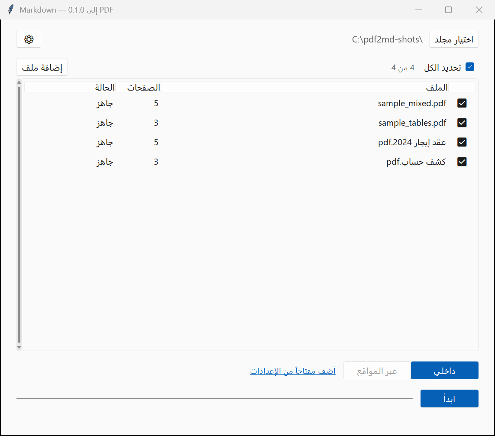

# pdf2md

<p align="center"></p>

<p align="center">
  <a href="https://github.com/Enezy1/pdf2md/releases/latest">
    
  </a>
</p>

<p align="center">
  
</p>


[](https://github.com/Enezy1/pdf2md/releases/latest)

**تحويل ملفات PDF إلى Markdown — مع العربية أولاً**

> برنامج لويندوز وماك يحوّل ملفات PDF — ولا سيما العربية — إلى نص Markdown منظَّم، يمكن كتابة تقرير منه مباشرة دون الرجوع إلى الملف الأصلي.



---

## ⬇️ تحميل البرنامج

**كل روابط التحميل في هذه الصفحة تُعطيك أحدث نسخة دائماً.** الروابط تشير إلى `releases/latest`، فلا تحتاج أن تعرف رقم الإصدار ولا تدوّر في صفحة الإصدارات — وحين ينزل إصدار جديد، نفس الأزرار تنزله.

### أيّ ملف أنزّل؟

| جهازك | الملف | الحجم | لماذا هذا |
|---|---|---|---|
| **ويندوز** | [**pdf2md-Setup.exe**](https://github.com/Enezy1/pdf2md/releases/latest/download/pdf2md-Setup.exe) | 66 ميغابايت | **الأفضل لأغلب الناس** — مثبّت لكل مستخدم بلا صلاحيات إدارية، ويظهر في «لوحة التحكم ← البرامج» ليُحذف منه |
| **ويندوز** | [**pdf2md.exe**](https://github.com/Enezy1/pdf2md/releases/latest/download/pdf2md.exe) | 65 ميغابايت | ملف محمول بلا تثبيت — شغّله مباشرة، واحذفه بحذف الملف |
| **ماك — Apple Silicon** | [**pdf2md-macos-arm64.dmg**](https://github.com/Enezy1/pdf2md/releases/latest/download/pdf2md-macos-arm64.dmg) | 65 ميغابايت | أجهزة M1/M2/M3/M4 — أي ماك حديث |
| **ماك — Intel** | [**pdf2md-macos-x64.dmg**](https://github.com/Enezy1/pdf2md/releases/latest/download/pdf2md-macos-x64.dmg) | 71 ميغابايت | Macs القديمة بمعالج Intel |

<table>
  <tr>
    <td align="center" width="33%"><a href="https://github.com/Enezy1/pdf2md/releases/latest/download/pdf2md-Setup.exe"></a><br>مثبّت — `.exe`</td>
    <td align="center" width="33%"><a href="https://github.com/Enezy1/pdf2md/releases/latest/download/pdf2md-macos-arm64.dmg"></a><br>Apple Silicon — `.dmg`</td>
    <td align="center" width="33%"><a href="https://github.com/Enezy1/pdf2md/releases/latest/download/pdf2md-macos-x64.dmg"></a><br>Intel — `.dmg`</td>
  </tr>
</table>

**كيف أعرف نوع معالج ماك؟** اضغط `Command` + المسافة واكتب `About This Mac`: إن كتب «Apple M1/M2/M3/M4» فأنت على **Apple Silicon** (arm64)، وإن كتب «Intel» فأنت على نسخة **Intel** (x64).

**بعد تنزيل نسخة ماك:** macOS يمنع تشغيل التطبيق أول مرة لأنه غير موقّع من Apple — اضغط بالزر الأيمن على التطبيق ثم **فتح**، أو من الطرفية:

```bash
xattr -dr com.apple.quarantine /Applications/pdf2md.app
```

التفاصيل كاملة في [نسخة ماك](#نسخة-ماك).

**كل النسخ السابقة:** [صفحة الإصدارات](https://github.com/Enezy1/pdf2md/releases) — فيها كل الإصدارات مع بصمات SHA256 للتحقق من سلامة الملف.

### التوقيع الرقمي

**Free code signing provided by SignPath.io, certificate by SignPath Foundation.**

طلبنا شهادة مجانية من [SignPath Foundation](https://signpath.org/apply) لهذا المشروع المفتوح. بمجرد موافقة مؤسسة SignPath Foundation على الطلب، تُوقَّع الملفات المنشورة (`pdf2md.exe` و`pdf2md-Setup.exe`) تلقائياً داخل خط الإنتاج، ويظهر الناشر باسم **SignPath Foundation** بدل «ناشر غير معروف» — بلا أي خطوة إضافية من المستخدم. التفاصيل الكاملة في [سياسة التوقيع الرقمي](docs/CODE_SIGNING.md).

---

## ماذا يفعل البرنامج؟

يقرأ البرنامج صفحات الملف صفحةً صفحة، ويحوّلها إلى Markdown جاهز:

- يستخرج النص والجداول والصور.
- يصحّح أخطاء القراءة الآلية، ولا سيما في اللغة العربية.
- يقيّم جودة كل صفحة، ويعيد الصفحات الضعيفة إلى المستخدم لمراجعتها.
- يحفظ النتيجة في ملف Markdown أو ملف Word بجوار الملف الأصلي.

الغاية الحقيقية من البرنامج هي تمكين المستخدم من كتابة تقرير انطلاقاً من النتيجة مباشرة، دون الرجوع إلى ملف PDF ثانية.

---

## نسخة ماك

نسخة الماك **سحابية فقط**: تعمل بمزوّدات Gemini و OpenAI-compatible و OCR.space و Google Vision. أما المحرّكات المحلية (PaddleOCR ونموذج الرؤية على جهازك) فمخصّصة لويندوز في هذه النسخة.

### التثبيت

من صفحة الإصدارات نزّل الملف المناسب لجهازك:

| الملف | الجهاز |
|---|---|
| [**pdf2md-macos-arm64.dmg**](https://github.com/Enezy1/pdf2md/releases/latest/download/pdf2md-macos-arm64.dmg) | Apple Silicon (M1/M2/M3/M4) |
| [**pdf2md-macos-x64.dmg**](https://github.com/Enezy1/pdf2md/releases/latest/download/pdf2md-macos-x64.dmg) | Intel |

(الروابط أعلحة دائماً تأخذ أحدث نسخة — لا حاجة للبحث عن رقم الإصدار.)

افتح الـ DMG، اسحب التطبيق إلى **Applications**، ثم شغّله من مجلّد التطبيقات.

### macOS سيمنع الفتح أول مرة — وهذا طبيعي

النسخة **بدون توقيع Apple Developer** (التوقيع من Apple يكلّف 99$ سنوياً)، وmacOS يمنع تشغيل أي تطبيق محمّل من الإنترنت لموقّع معروف. لذلك عند أول تشغيل:

1. **اضغط بالزر الأيمن على التطبيق ← فتح** (Open). بعدها يفتح طبيعياً في كل مرة.
2. أو من الطرفية:

   ```bash
   xattr -dr com.apple.quarantine /Applications/pdf2md.app
   ```

### التحقق من سلامة الملف

كل ملف ماك يحمل بصمة SHA256 في `SHA256SUMS-macos-arm64.txt` أو `SHA256SUMS-macos-x64.txt`:

```bash
shasum -a 256 pdf2md-macos-arm64.dmg
```

ثم قارن النتيجة بالسطر الموجود في ملف البصمات.

### من المصدر على ماك

```bash
git clone https://github.com/Enezy1/pdf2md.git
cd pdf2md

python3 -m venv .venv
source .venv/bin/activate

pip install -r requirements.txt
python main.py
```

فحص سريع:

```bash
python main.py --selftest
```

### أين تُحفظ بيانات البرنامج على ماك

| ما | أين |
|---|---|
| الإعدادات والمفاتيح وسجلّات الإرسال | `~/Library/Application Support/pdf2md` |
| ملفات العمل المؤقتة | `$TMPDIR/pdf2md` (تُنظَّف بعد أسبوع) |
| المفاتيح | **Keychain** (مدير مفاتيح macOS) |

### بناء نسخة ماك بنفسك

```bash
pip install pyinstaller
python -m PyInstaller pdf2md.spec --noconfirm   # ينتج dist/pdf2md.app
bash installer/make_dmg.sh arm64                 # يوقّع ذاتياً ويصنع DMG و zip
```

---

## ثلاث طرق لقراءة الصفحة

يقرأ البرنامج كل صفحة بثلاث طرق ممكنة، ويقرّر لكل صفحة على حدة أيّهما يناسبها. وليس من الضروري اختيار طريقة واحدة لكل ملف.

### ١) داخل الجهاز — الوضع «داخلي»

تعمل كل شيء على جهاز المستخدم: لا إنترنت، ولا مفتاح، ولا حدّ يومي، ولا ملف يخرج من الجهاز.

يوجد محرّكان محليان:

- قارئ نصوص عربي مدمج يعمل بالكامل دون كرت شاشة.

  PaddleOCR

- نموذج رؤية صغير يمكن تنزيله على الجهاز وتشغيله على المعالج العادي، دون كرت شاشة.

  Qwen3-VL 4B

### ٢) قراءة عبر الإنترنت — دون ذكاء اصطناعي

تعمل محركات القراءة على خوادم الطرف الثالث. يُرسَل إلى الخادم صورة الصفحة فقط، وتُؤخذ النتيجة نصاً.

- قارئ نصوص تقليدي، سريع، ومقبول في العربية — أي بدقّة عالية؟ لا.

  OCR.space

- ذكاء اصطناعي مخصّص للعربية، يعمل على خوادم خارجية.

  Qari-OCR

- محرك قراءة من Google، قوي في العربية والجداول الممسوحة، لكنه يتطلّب تفعيل الفوترة.

  Google Cloud Vision

### ٣) ذكاء اصطناعي خارجي

نموذج ذكي يقرأ الصفحة، ويصحّح النص، ويضبط الجداول. وهو أدقّ في الجداول من قارئ النص العادي، لكنه يتطلّب مفتاح API.

  Google Gemini

  OpenAI

  Groq

  Mistral

  Cloudflare Workers AI

  NVIDIA NIM

  MiniMax

  OpenRouter

---

## ⚠️ ملاحظة مهمة قبل إضافة مفتاح Google

**سقف مفتاح Gemini عند Google يعادل نحو ٣٠ ألف مستند في اليوم.**

فإذا تجاوز المستخدم هذا الحدّ، لن يحوّل البرنامج بقية الملفات إلا بالدفع أو بالانتظار حتى اليوم التالي. والسقف مطبَّق على مستوى المشروع، ويُصفَّر كل يوم.

> الأرقام الدقيقة الخاصة بالحساب تظهر في:
>
> https://aistudio.google.com/rate-limit

وثمّة ملاحظة ثانية لا تقلّ أهمية، وتخصّ الخطة المجانية بصفة خاصة:

> **محتوى المستند الذي يرسله البرنامج قد يُستخدَم في تحسين منتجات Google.**

ولهذا السبب، **يُنصح بالوضع الداخلي** إلا إذا احتاج المستخدم دقة النموذج الخارجي فعلاً:

- لا تخرج مستندات المستخدم من جهازه إطلاقاً.
- لا يوجد سقف يومي، ولا تكلفة، ولا انتظار.
- يعمل البرنامج حتى عند انقطاع الإنترنت.

الوضع الداخلي هو الوضع الافتراضي، وهو ما ينبغي البدء به. يُجرَّب أولاً، وإذا لم تناسب النتيجة، يُفعَّل الوضع الخارجي للملفات الصعبة فقط.

---

## أيّهما أختار؟

| الحالة | الخيار المناسب |
|---|---|
| مستندات حسّاسة أو قانونية | الوضع الداخلي |
| العمل على الجهاز دون إنترنت | الوضع الداخلي |
| ملف واحد مهم مع الحاجة إلى دقة عالية | ذكاء اصطناعي خارجي |
| آلاف الملفات المتشابهة | الوضع الداخلي أو محرك قراءة عبر الإنترنت |
| جداول معقّدة أو صفحات مدوّرة | ذكاء اصطناعي خارجي |

---

## المميزات

- واجهة عربية بالكامل، من اليمين إلى اليسار، تتتبّع وضعَي ويندوز الفاتح والداكن.
- استخراج الجداول وترتيبها داخل النص.
- قاموس عربي لتوحيد الأرقام: ١٢٣ تصبح 123.
- درجة جودة لكل صفحة، ونافذة مراجعة للصفحات ذات المشكلة.
- الاستئناف من موضع التوقف عند انقطاع العملية.
- فهرس للملفات وملخّص لكل مستند.
- مخرجات بصيغة Markdown وملف Word.
- تُحفظ أوقات المعالجة وملفات العمل في مجلّد مؤقّت، وتُنظَّف بعد أسبوع.

---

## المتطلبات

- **ويندوز:** ويندوز 10 أو 11. أو **ماك:** macOS 11 (Big Sur) أو أحدث.
- بايثون 3.9 أو أحدث — عند الرغبة في تشغيل البرنامج من المصدر.
- كرت شاشة (اختياري): مهم للنموذج الذكي الداخلي — يعمل بدونه، لكن وجوده يسرّع عملية التحويل.
- المحرّكات المحلية (نموذج الرؤية على جهازك و PaddleOCR) متاحة على **ويندوز فقط** في هذه النسخة. نسخة الماك سحابية فقط.

---

## التشغيل

### الطريقة الموصى بها: المثبّت

يُنزَّل `pdf2md-Setup.exe` من صفحة الإصدارات ويُشغَّل:

  https://github.com/Enezy1/pdf2md/releases/latest/download/pdf2md-Setup.exe

المثبّت:

- **لا يطلب صلاحيات إدارية** — التثبيت لكل مستخدم، في `%LOCALAPPDATA%\Programs\pdf2md`.
- يضيف **مدخلاً في لوحة التحكم ← البرامج** باسم `pdf2md`، ومنه يمكن حذفه أو تعديله أو إصلاحه.
- يضيف اختصارات في قائمة ابدأ (وعلى سطح المكتب إن اخترت ذلك).
- شريط إزالة البرنامج (Uninstall) موجود في قائمة ابدأ أيضاً.

عند الإزالة من لوحة التحكم، يسألك إن كنت تريد حذف إعدادات البرنامج ومفاتيحه المحفوظة في `%APPDATA%\pdf2md` — فالإعدادات لا تُحذف إلا بطلبك.

### طريقة سريعة: ملف محمول بلا تثبيت

يُنزَّل `pdf2md.exe` من صفحة الإصدارات، ثم يُشغَّل مباشرة. لا يحتاج بايثون ولا تثبيت أي شيء، لكنه لا يظهر في لوحة التحكم (لأنه ليس مثبّتاً) — احذفه بمجرد حذف الملف، ومجلد `%APPDATA%\pdf2md` يبقى للبيانات.

ولمن يريد مدخل الكليك اليمين مع النسخة المحمولة، الإصدار `pdf2md-portable.zip` يحتوي على `pdf2md.exe` مع `Register.cmd` (تسجيل المدخل) و`Unregister.cmd` (حذفه) — انظر «مدخل الكليك اليمين في ويندوز» أدناه.

### من المصدر

```powershell
git clone https://github.com/Enezy1/pdf2md.git
cd pdf2md

python -m venv .venv
.venv\Scripts\activate

pip install -r requirements.txt
python main.py
```

### فحص سريع للبرنامج

```powershell
python main.py --selftest
```

---

## مدخل الكليك اليمين في ويندوز

في مستكشف ويندوز، كليك يمين على ملف أو مجلد (أو على المساحة الفارغة داخل مجلد) — يظهر مدخل **pdf2md**، وهو في ويندوز 11 تحت «عرض المزيد من الخيارات» (Show more options).

| ما نُقر عليه | ما يفعله البرنامج |
|---|---|
| ملف | يفتح على الملف، ويضعه في القائمة جاهزاً للتحويل |
| مجلد | يفتح على المجلد كـ«مجلد عمل»، ويضع كل ملفات PDF والصور داخله في القائمة |
| المساحة الفارغة داخل مجلد، أو سطح المكتب | يفتح على نفس المجلد |

### من يظهر له المدخل؟

| الطريقة | من يرى المدخل | صلاحيات مدير |
|---|---|---|
| المثبّت `pdf2md-Setup.exe` | المستخدم الذي ثبّت البرنامج فقط | لا |
| `installer\win\Install-AllUsers.ps1` | **كل المستخدمين على الجهاز** | نعم |
| النسخة المحمولة `pdf2md-portable.zip` ← `Register.cmd` | المستخدم الذي نفّذ التسجيل | لا |

السبب: المدخل يُكتب في `HKEY_CURRENT_USER` افتراضياً، وهو خاص بكل حساب في ويندوز. فحساب آخر على نفس الجهاز لا يراه — إلا إذا سجّلته على مستوى الجهاز كله.

### لا يعمل على جهازي؟ شغّل التشخيص

عناوين كثيرة: «المدخل موجود في القائمة، لكن الضغط عليه لا يفتح شيئاً». عادةً يكون السبب واحداً من ثلاثة: الملف المسجّل مساره لم يعد موجوداً (نُقل المجلد)، أو مضاد الفيروسات حذّر الملف، أو المدخل لم يُسجَّل أصلاً.

لذلك مع كل نسخة (المثبّت والنسخة المحمولة) يجيء **تشخيص** يشرح الحالة بالضبط:

| النسخة | كيف تشغّل التشخيص |
|---|---|
| المثبّت | قائمة ابدأ ← **تشخيص pdf2md** |
| المحمولة | نقر مزدوج على `Diagnose.cmd` داخل المجلد |

يفحص: هل المدخل مسجّل وله أي مسار؟ هل الملف في مساره؟ هل هو محجوب (Mark of the Web) أو حذفه Defender؟ وهل البرنامج يفتح فعلاً؟ ثم يقول لك الحل في سطر واحد. التقرير الكامل يُحفظ في `%TEMP%\pdf2md-doctor.txt`، ولا يغيّر أي شيء.

وللمشكلة نفسها من سطر الأوامر:

```powershell
powershell -NoProfile -ExecutionPolicy Bypass -File "%LOCALAPPDATA%\Programs\pdf2md\installer\pdf2md-doctor.ps1"
```

### تحذير: الملف غير موقّع رقمياً

الملفات المنشورة (`pdf2md.exe` و`pdf2md-Setup.exe`) **غير موقّعة** حالياً، فويندوز قد يعرض «حماية ويندوز لجهازك» عند أول تشغيل. اختر **مزيد من المعلومات ← تشغيل على أي حال**. التوقيع عبر SignPath Foundation **مطلوب ومُرسل** للمشروع المفتوح، وما عليه إلا موافقة المؤسسة (نحو أسبوع) ليصبح كل إصدار جديد موقّعاً تلقائياً — انظر [التوقيع الرقمي](#التوقيع-الرقمي) و`docs/CODE_SIGNING.md`.

إن حذف مضاد الفيروسات الملف، أضف استثناءً لمجلد التثبيت (`%LOCALAPPDATA%\Programs\pdf2md`) في `Windows Security ← Virus & threat protection ← Manage settings ← Exclusions`.

### تسجيل المدخل لكل المستخدمين على جهاز واحد

```powershell
powershell -NoProfile -ExecutionPolicy Bypass -File installer\win\Install-AllUsers.ps1
```

السكربت يطلب صلاحيات المدير من ويندوز (نافذة UAC) ثم يكتب المدخل في `HKEY_LOCAL_MACHINE`، فيظهر لكل الحسابات على الجهاز. وهو يحذف نسخة المستخدم الواحد عندها، فيبقى مدخل واحد مشترك للجميع.

شروط مهمة:

- **البرنامج في مسار يقرأه كل المستخدمين.** المسار الافتراضي `D:\MARKDOWN\pdf2md` يقرأه `Users` أصلاً، لكن إن نقلت البرنامج فضعه في مكان عام مثل `C:\Program Files\pdf2md` أو `C:\Tools\pdf2md`.
- إن لم يكن البرنامج في ذلك المسار، حدّده صراحة: `-AppExe "C:\Tools\pdf2md\pdf2md.exe"`.
- الحذف: نفس السكربت مع `-Uninstall` (يحذف من النطاقين معاً).

### النسخة المحمولة (Portable)

المدخل في كليك اليمين **مدخل في الريجستري**، وهذا يعني أن النسخة المحمولة نفسها لا تستطيع تسجيل نفسها بلا أثر — ما لم يشغّل المستخدم سكربت التسجيل بنفسه.

لذلك الإصدار `pdf2md-portable.zip` يحتوي على:

| الملف | الوظيفة |
|---|---|
| `pdf2md.exe` | البرنامج نفسه |
| `Register.cmd` | تسجيل المدخل لهذا المستخدم (نقر مزدوج، بلا صلاحيات مدير) |
| `Unregister.cmd` | حذف المدخل |
| `Diagnose.cmd` | تشخيص: أين المشكلة إن لم يفتح المدخل |
| `Install-AllUsers.ps1` | تسجيل المدخل لكل المستخدمين (يتطلب UAC) |
| `README.txt` | التعليمات كاملة |

بنيان حزمة محمولة من المصدر:

```powershell
powershell -NoProfile -ExecutionPolicy Bypass -File installer\win\Make-Portable.ps1
```

الناتج في `dist-portable\pdf2md-portable`. تنبيه مهم: لو نقلت المجلد أو حذفته بعد التسجيل، يبقى المدخل في ويندوز لكنه لن يفتح شيئاً — سجّل الحذف أولاً بـ `Unregister.cmd`، أو أعد التسجيل من المسار الجديد.

---

## بناء ملف تنفيذي مستقل ومثبّت

```powershell
pip install pyinstaller
pyinstaller pdf2md.spec
```

ينتج الملف في مجلّد `dist`. وهذا المجلّد لا يُرفع على GitHub، فهو ملفات مولَّدة لا كود.

وبناء المثبّت يحتاج [Inno Setup 6](https://jrsoftware.org/isinfo.php):

```powershell
& 'C:\Program Files (x86)\Inno Setup 6\ISCC.exe' `
  "/DPdf2mdExe=$((Resolve-Path 'dist\pdf2md.exe').Path)" `
  "/DOutputDir=$((Resolve-Path 'dist').Path)" `
  "/DAppVersion=1.0.5" `
  'installer\pdf2md.iss'
```

في GitHub Actions يُبنى المثبّت تلقائياً مع كل وسم `v*` — انظر `docs/CODE_SIGNING.md`.

---

## الاختبارات

```powershell
python -m pytest tests/ -v
```

---

## التحقق من سلامة الملف

الملف التنفيذي **منشور بدون توقيع رقمي** (الشهادة التجارية تحتاج شركة معتمدة وكلفة سنوية)، فبدلاً منه نوفّر لك طريقتين مجانيتين للتحقق:

**١) بصمة SHA256**

كل إصدار يحمل ملف `SHA256SUMS.txt`. بعد التنزيل، افتح PowerShell في نفس المجلد ونفّذ:

```powershell
Get-FileHash .\pdf2md.exe -Algorithm SHA256
```

ثم قارن النتيجة بالسطر الموجود في `SHA256SUMS.txt`. تطابق البصمتان = الملف أصلي ولم يتغيّر.

**٢) إثبات مصدر البناء**

كل إصدار جديد يُبنى داخل GitHub Actions، ويُنشأ له «إثبات» يربطه بالـ commit الذي بُني منه. للتحقق:

```powershell
gh attestation verify pdf2md.exe --repo Enezy1/pdf2md
```

وتحتاج لتثبيت [GitHub CLI](https://cli.github.com) مرة واحدة.

الشرح الكامل في الملف:

  docs/CODE_SIGNING.md

---

## Code signing policy — سياسة التوقيع الرقمي

هذه السياسة تشرح ما الذي يُوقَّع مستقبلاً، ومن يوقّعه، وكيف يُتحقق من الملف. على المتصفحات التي تدعم الترجمة قد يظهر العنوان بالإنجليزية.

- **الحالة الآن**: الإصدارات منشورة **بدون** توقيع رقمي، ومغطاة ببصمة SHA256 وإثبات مصدر البناء.
- **عند توفر توقيع رسمي**: يُوقَّع ملف `pdf2md.exe` فقط، المبني من وسم `v*` داخل هذا المستودع، وتُوقَّع كل نسخة يدوياً بموافقة صريحة.
- **الأدوار**: المطوّرون يراجعون، وصاحب المستودع هو الوحيد الذي يعتمد الإصدار.
- **الخصوصية**: البرنامج لا ينقل أي بيانات إلى أجهزة أخرى إلا بطلب صريح من المستخدم.

التفاصيل الكاملة:

  docs/CODE_SIGNING.md

---

## بنية المشروع

```text
pdf2md/
├── main.py                  نقطة التشغيل
├── pdf2md.spec              إعدادات بناء الملف التنفيذي
├── .github/workflows/       البناء الآلي والتحقق من مصدر البناء
├── docs/                    سياسة التوقيع الرقمي
├── installer/
│   ├── pdf2md.iss           مثبّت Inno Setup (ويندوز)
│   └── win/
│       ├── Install-ContextMenu.ps1   تسجيل مدخل الكليك اليمين (مستخدم واحد / كل المستخدمين)
│       ├── Install-AllUsers.ps1      تسجيل لكل المستخدمين (يرفع الصلاحيات بنفسه)
│       ├── Make-Portable.ps1         بناء النسخة المحمولة
│       ├── pdf2md-doctor.ps1         تشخيص مدخل الكليك اليمين (لماذا لا يفتح)
│       ├── Diagnose.cmd              اختصار تشخيص يعمل بنقرة مزدوجة
│       └── pdf2md-open.ps1           تشغيل البرنامج على الملف/المجلد المنقور عليه
├── app/
│   ├── ui/                  الواجهة
│   ├── providers/           محركات القراءة والمزوّدات
│   ├── pipeline.py          خط المعالجة
│   ├── markdown_out.py      إخراج Markdown
│   ├── docx_out.py          إخراج Word
│   ├── tables.py            استخراج الجداول
│   ├── dictionary.py        القاموس العربي
│   ├── quality.py           تقييم جودة الصفحات
│   ├── cloud_gate.py        بوابة إرسال الملفات
│   ├── secrets_store.py     حفظ المفاتيح
│   └── config.py            الإعدادات
├── resources/               كتالوج المزوّدين
├── samples/                 ملفات PDF تجريبية
├── screenshots/             لقطات الشاشة
├── style/                   أسلوب كتابة التقارير (مخطَّط)
├── tests/                   الاختبارات
└── DEVLOG.md                سجل التطوير
```

---

## الإعدادات والمفاتيح

- تُحفظ المفاتيح في مخزن بيانات الاعتماد في ويندوز، أو **Keychain** في ماك، أو بتشفير خاص بالجهاز إن تعذّر ذلك.
- تُحفظ الإعدادات في مجلّد بيانات التطبيق:
  - `%APPDATA%\pdf2md` في ويندوز
  - `~/Library/Application Support/pdf2md` في ماك
- **لا يوجد أي مفتاح داخل المستودع** — هذه الملفات مستبعَدة جميعها عبر ملف `.gitignore`.
- في الوضع الداخلي، يمنع الكود نفسه أي اتصال خارجي يحمل محتوى المستند.
- في الوضع الخارجي، يمرّ كل إرسال عبر بوابة واحدة تفحص الملف قبل خروجه، ويُسجَّل في سجل لا يحتوي على نص المستند.

---

## المساهمة

المساهمات والملاحظات مرحّب بها. يُفتح Issue للإبلاغ عن خطأ أو لطلب ميزة.

ويوجد سجل التطوير الكامل في الملف:

  DEVLOG.md

---

## الرخصة

رخصة MIT — تسمح باستخدام البرنامج وتعديله ومشاركته.
