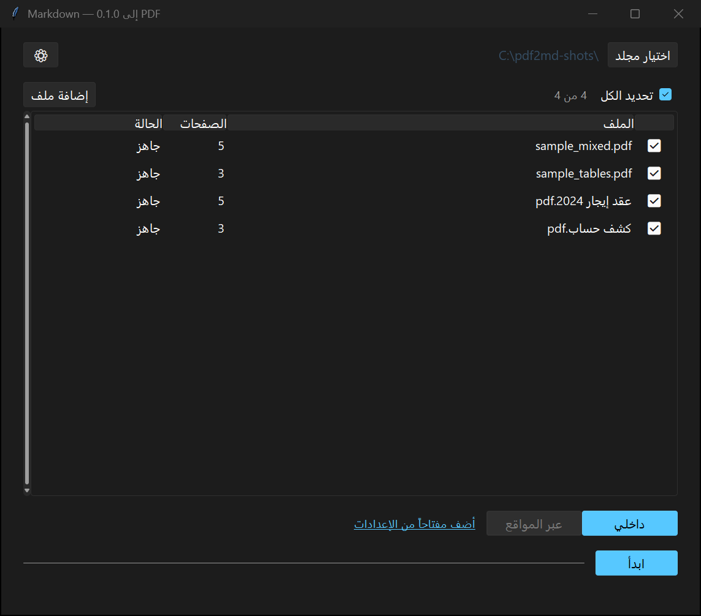

# pdf2md — تحويل PDF إلى Markdown

> برنامج ويندوز مكتبي يحوّل ملفات PDF (خصوصاً العربية) إلى Markdown نظيف جاهز للكتابة والتقارير.




**pdf2md** ما يكتفي بنسخ النص: يستخرج الجداول، يقيّم جودة كل صفحة، يراجع الصفحات المشكوك فيها، ويصحّح أخطاء الـ OCR الشائعة — خصوصاً العربية. النتيجة ملف Markdown تقدر تكتب تقرير منه **بدون ما ترجع للـ PDF**.

---

## 🎯 شو يسوي بالضبط

| | |
|---|---|
| **📥 استخراج** | نصوص، جداول، وصور من الـ PDF |
| **🔤 تطبيع عربي** | قاموس عربي + تصحيح أرقام يوحّد شكل «١٢٣» و «123» |
| **📊 جداول** | استخراج الجداول كمحتوى Markdown نظيف |
| **⭐ تقييم جودة** | درجة لكل صفحة، والصفحات الضعيفة تنتقل للمراجعة |
| **🖼️ مراجعة** | نافذة مراجعة تعرض الصفحة جنب النص المستخرج وتسمح لك بالتصحيح |
| **📄 مخرجات** | Markdown (`.md`) و Word (`.docx`) |
| **📇 فهرس وبوابة** | فهرس للملفات، وملخص لكل مستند |
| **⏱️ استئناف** | Checkpoint: لو توقف، يكمل من وين وقف |

---

## 🔒 وضعان: «داخلي» و«عبر المواقع»

| | **داخلي** (الافتراضي) | **عبر المواقع** |
|---|---|---|
| وين تشتغل | على جهازك بالكامل | ترسل الصفحات لمزوّدي OCR |
| هل المحتوى يطلع من جهازك | **لا** — يمنعها الكود نفسه | نعم، لكل صفحة تُرسل |
| المحركات | موديل llama محلي | OCR.space ثم مصحّح LLM، Gemini، OpenAI-compatible، Google Vision، Qari |
| المتطلبات | بدون مفتاح API | مفتاح API للمزوّد |

> **الخصوصية مطبَّقة بالكود مو بالواجهة فقط:** في وضع «داخلي» يُمنع أي اتصال خارجي يحمل محتوى المستند. في وضع «عبر المواقع» كل إرسال يمر على بوابة واحدة (`cloud_gate`) تفحص بصمة الملف قبل كل إرسال، وتسجّل كل محاولة في `sent_log.csv` **بدون نص المستند**.

**مفاتيح API** تُحفظ في مدير بيانات الاعتماد في ويندوز (keyring) أو عبر DPAPI، والإعدادات في `%APPDATA%\pdf2md\settings.json` — **كلها خارج المستودع**.

---

## 🚀 التشغيل

```bash
git clone https://github.com/tch333-byte/pdf2md.git
cd pdf2md

python -m venv .venv
.venv\Scripts\activate          # ويندوز
# source .venv/bin/activate     # لينكس / ماك

pip install -r requirements.txt
python main.py
```

اختبار سريع للبرنامج:

```bash
python main.py --selftest
```

### بناء ملف exe مستقل

```bash
pip install pyinstaller
pyinstaller pdf2md.spec
```

الناتج في `dist\pdf2md.exe` (نسخة بملف واحد) أو `dist\pdf2md\pdf2md.exe` (نسخة مجلد).

> **ملفات البناء (`build/` و `dist/`) ما تنرفع على GitHub** — هي ملفات مولّدة، مو كود.

---

## 🧪 الاختبارات

```bash
python -m pytest tests/ -v
```

---

## 🗂️ بنية المشروع

```
pdf2md/
├── main.py                  نقطة التشغيل (و --selftest)
├── pdf2md.spec              إعدادات PyInstaller
├── app/
│   ├── ui/                  الواجهة (CustomTkinter + sv-ttk)
│   │   ├── main_window.py
│   │   ├── settings_window.py
│   │   └── review_window.py
│   ├── providers/           محركات OCR والمزوّدات
│   │   ├── local_llama.py   الموديل المحلي
│   │   ├── ocrspace.py      OCR.space
│   │   ├── gemini.py        Google Gemini
│   │   ├── openai_compat.py أي مزوّد متوافق مع OpenAI
│   │   ├── google_vision.py Google Vision
│   │   └── qari_api.py      Qari
│   ├── pipeline.py          خط المعالجة
│   ├── markdown_out.py      إخراج Markdown
│   ├── docx_out.py          إخراج Word
│   ├── tables.py            استخراج الجداول
│   ├── dictionary.py        القاموس العربي
│   ├── quality.py           تقييم جودة الصفحات
│   ├── cloud_gate.py        بوابة إرسال الملفات
│   ├── secrets_store.py     حفظ المفاتيح
│   └── config.py            الإعدادات
├── resources/               موارد (كتالوج المزوّدين)
├── samples/                 ملفات PDF تجريبية
├── screenshots/             لقطات الشاشة
├── style/                   (محجوز) أسلوب كتابة التقارير
├── tests/                   الاختبارات
└── DEVLOG.md                سجل تطوير كامل
```

---

## 🧭 إذا تبي تساهم

- افتح **Issue** للبلاغ خطأ أو طلب ميزة.
- الفرع الأساسي هو `master` — اعمل فرع جديد للتجارب (`git switch -c feature/x`).
- **سجل التطوير الكامل في [DEVLOG.md](DEVLOG.md)** — كل قرار تقني وشو تغيّر.

---

## 📄 الرخصة

MIT — شوف [LICENSE](LICENSE).
